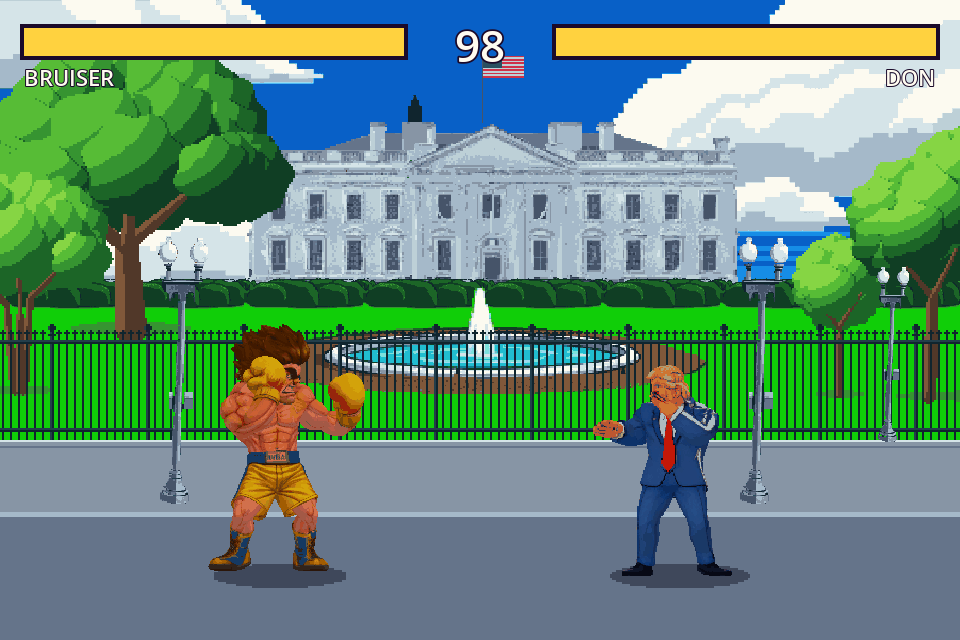
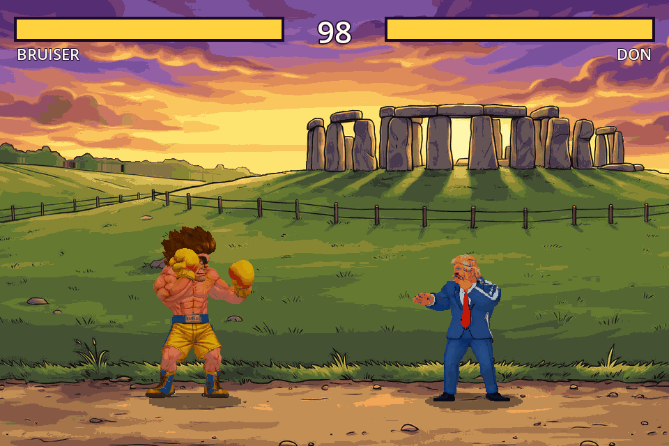

# Fighting game sprite pipeline

## Gameplay screenshots

Captured from the running Godot game at 960 x 640, with Bruiser versus Don.

### White House



### Stonehenge (offline draft art)



## Reference-to-level art workflow

Use `.github\skills\reference-level-generator\SKILL.md` with the versioned
`assets\workflows\reference_level.json` process to turn landscape references into
layered stages. It preserves the game's vibrant, outlined, cel-shaded 90s arcade
style, using an approved fighter sheet for style and scale rather than adopting
the reference's painterly finish.

The workflow separates **two edits of the original reference**: a Nano Banana
edit removing foreground detail while keeping the sky, distant skyline and a
subtle landscape underlay becomes a fixed, opaque lightbox; a separate edit using
**"remove the sky from the image and replace it with a solid blue sky"** isolates
the geometry reference for Tripo. The uniform blue is an intermediate isolation
backdrop, never part of the generated meshes or the final sky. Retain masks and
check enclosed sky gaps, thin fences and blue halos. Tripo's actual multi-object
or segmentation capability must be verified before generation; a fused landscape
mesh is not an acceptable independently editable scene. Assign each identifiable
feature to one layer in `source\layer_plan.json`; do not duplicate distant
silhouettes retained in the static lightbox in moving geometry. The lightbox's
subtle underlay is atmospheric scenery, not the playable floor or a prop layer.

Blender assembly gives the scene separate cel-shaded background/foreground
collections and reusable props, while creating a new deterministic flat floor.
At the current **960 x 640** viewport, the bottom **15%** (y = 544..639) is
protected, full-width, level ground. The wider bottom **30%** staging zone allows
props above that strip; hills and foreground rocks cannot intrude into it.
The sky is screen-locked; the four moving layers use camera ratios
0.2 / 0.5 / 1.0 / 1.15. Default art is 2400 pixels wide with 960 pixels of camera
travel, checked for parallax overscan. Letterbox different aspect ratios; do not
stretch the reference to fit. Use one approved stage palette of at most 31 opaque
colors plus transparency, no dithering, and nearest-neighbor filtering.

The **local tooling is implemented** for initialization, technical validation,
and left/center/right compositing. Image-model editing, paid Tripo scene
generation, Blender assembly/export, and Godot gameplay integration are explicit
agent/artist checkpoints, **not automated API calls or an existing stage loader**.
Initializing a job never uploads an image or spends credits. Remote image edits
need explicit upload approval; Tripo also needs explicit paid-call approval.
Reuse cached models and saved task IDs before submitting anything new.

```powershell
python scripts\level_pipeline.py init --reference "C:\path\landscape.jpg" --style-reference assets\spritesheets\Bruiser_idle_sheet.png --output assets\levels\stone_circle
```

This creates `level.json`, `prompts.json`, a `layout.png` guide, an empty
`palette.json`, and a Godot-excluded `source` folder containing input copies and
hash provenance. It refuses to overwrite an existing job. **No stage art is
generated by `init`.** Inspect the guide, approve the palette, then follow the
skill's generation, mesh separation, Blender and export steps. Record provider,
prompt, seed, model revision, masks, task IDs and render settings in
`source\provenance.json`; do not store credentials there.

Final layers are `sky.png` (960 x 640, opaque) and `far_background.png`,
`midground.png`, `ground.png`, `foreground.png` (2400 x 640, binary alpha).
All non-ground layers and props must be transparent in the protected lane;
ground must be transparent above it and fully opaque below its straight top.
The required foreground PNG may be fully transparent when the stage has no
foreground objects; do not invent obstacles just to populate that layer.
`palette.json` has the form `{"colors": [[90, 30, 60], [60, 100, 20]]}` with
the actual approved colors, not these illustrative swatches.
Props are independently reusable PNGs; add instances to the manifest's `props`
array, with top-left positions in world-art pixels and local pivots:

```json
{
  "id": "rock_01",
  "image": "props/rock.png",
  "layer": "foreground",
  "size": [32, 24],
  "position": [920, 512],
  "pivot": [16, 23],
  "collision": false
}
```

JSON uses portable relative asset names; Windows CLI arguments use backslashes.
Multiple instances may share the same prop PNG. Instance IDs must be unique.
Props inherit their layer's camera ratio and painter order, and cannot be placed
on the sky or ground layer.

```powershell
python scripts\level_pipeline.py validate --level assets\levels\stone_circle
python scripts\level_pipeline.py preview --level assets\levels\stone_circle --output temp\stone_circle\camera_strip.png
python scripts\level_pipeline.py validate --level assets\levels\stone_circle --release
python -m unittest discover -s tests -p "test_level_*.py"
```

Add `--fighter assets\spritesheets\Bruiser_idle_sheet.json` to `preview` to
draw two scale-reference fighters on the lane baseline.

### Offline draft derivation (example: `assets\levels\stonehenge`)

Without approved remote generation, `scripts\level_derive.py` derives a
deterministic, validated draft stage directly from the reference, using the
job's `source\derive_recipe.json` (it requires `numpy`, listed in
`requirements.txt`):

```powershell
python scripts\level_derive.py derive --level assets\levels\stonehenge
python scripts\level_pipeline.py preview --level assets\levels\stonehenge --output temp\stonehenge\camera_strip.png --fighter assets\spritesheets\Bruiser_idle_sheet.json
```

The Stonehenge level is such a draft. It has a 1660 px world, 600 px camera
travel, a heuristic sky lightbox, far, mid, ground and foreground layers, and
reusable stone and grass-tuft props. Its review gates remain `false`. The
Nano Banana, Tripo and Blender path was not run for it. See the skill for the
recipe format and limitations.

`assets\levels\white_house` is a **playable, reference-derived production stage**
registered by `stages\white_house\stage.json`. Nano Banana removed the people and
temporary inauguration barricades, produced a daytime lightbox and isolated the
geometry reference. Tripo generated and textured 20 selectable meshes; Blender
4.5 LTS assembled/repaired them and rendered the cel-shaded house. Following
playtest feedback, the distorted 3D yard exports were replaced with independent
reference-textured **2.5D Blender cards**, preserving the generated reference's
hedge shapes and level fountain. This is a documented hybrid
repair, not newly generated 3D yard geometry. A later playtest found the card
trees clipped by their source boxes and stylistically too thin, and the fence
too small beside the fighters. `scripts\stage_pixel_props.py` now paints the
seven trees and a larger 96x124 tiling iron-fence module (spear-tipped bars,
posts, rails and curb on the sidewalk edge at y=448) as **deterministic,
palette-locked 2 px procedural pixel art** from the recipe's `pixel_art`
section. These are not Tripo, Blender or image-model output; no remote service
is used. The accepted house and sky source
images are preserved; yard colors cannot replace their palette
entries. The sky remains byte-identical. A subsequent user-requested depth
adjustment displays the garden/house at 85% scale, enlarges the fountain to about
153% of its previous size, and expands the foreground to y=448..639:
a 64 px decorative sidewalk followed by 128 px of protected fighting road
(y=512..639). Four larger reusable streetlights stand on the sidewalk plane
(sidewalk parallax band, drawn over the fence but behind the fighters) and end
before the road. The lamp sprite is cleaned of the reference tree trunk, vines
and fringe that stood behind it. The trees nearest the fence stand back on the
lawn (bases at least 40 px above the fence line) with a slight perspective
scale-down via the tree spec's optional `scale`. The house and its flag sit 14 px
lower so the foundation is hidden behind the hedge row, and the open portico and
foundation gaps in the house art are closed with a recessed porch shade
(`house_grounding` in the recipe) so no sky shows beneath the building; the
approved house pixels themselves are unchanged. Fighters retain
their original scale and y=576 collision baseline. The stage
retains the permanent iron fence, fountain, rooftop flag and a screen-locked
distant Monument, with reusable fence, lamp, fountain, hedge and flag sprites.
Its shared palette has 31 opaque colors plus transparency. The 2400 px artwork
supports 960 px of camera travel; all scenery ends above the widened flat lane.

The level manifest keeps the four locked workflow layers, but the Godot runtime
(`stages\white_house\stage.json`) splits the yard into depth bands using the
recipe's `parallax` section. Each yard prop scrolls at a ratio interpolated from
where it touches the ground (0.3 at the hedge line to 0.7 at the fence, in 0.05
steps). The flat midground image is drawn as two `region` crops: the lawn (≈0.45)
and the sidewalk (0.8, shared by the streetlights so they never skate). Together
with the house (0.2), road (1.0) and foreground (1.15), this gives ten moving
scroll speeds. Rebuild only `stage.json` from the committed manifest with
`python scripts\white_house_stage.py stage`; `compile` also runs this step.

Cached GLBs, `source\stage.blend`, raw render passes and provider upload handles
stay local and are git-ignored; input references, masks, task provenance and the
assembly recipe are retained with the exported stage. With those local caches
present, regenerate without remote calls using:

```powershell
python scripts\white_house_stage.py prepare-yard
& $env:BLENDER_EXE --background --factory-startup --python-exit-code 1 --python scripts\white_house_stage.py -- render
python scripts\white_house_stage.py compile
python scripts\level_pipeline.py validate --level assets\levels\white_house
godot --headless --path . --script tests\test_white_house.gd
```

The four human artistic/game review gates remain `false`; successful generation
and technical/in-engine checks are not release approval.

`validate` checks image dimensions, shared palette, true binary transparency,
sky locking, layer order/ratios, parallax coverage and pixel-exact flat lane
coverage/clearance. `preview` runs those checks first, then writes three camera
views without changing the inputs. Optional `--fighter` actors are scale
references only, and it does not simulate collisions. A full in-engine camera sweep with fighters/HUD is a required visual
checkpoint. `--release` additionally requires the four explicit review booleans
`style`, `sky_clean`, `composition`, and `in_game`; do not set them automatically.
Technical checks cannot detect an unwanted stone painted into the sky or prove
artistic style consistency.

For Godot integration, follow the skill's runtime contract: a background
`CanvasLayer` lightbox and horizontal `ParallaxBackground` / `ParallaxLayer`
composition compatible with Godot 4.3. Keep a fixed orthographic frame, a straight
collision baseline aligned with the artwork, and nearest filtering. "Lightbox"
is a visual/color reference, not physical lighting in this 2D viewer. The current
animation lab stays unchanged. A future export preset must explicitly include
the stage JSON/palette files and PNG resources.

## Godot fighting-game template

Open the root `project.godot` in **Godot 4.3 or newer** and press **F5** for
Title -> Character Select -> Stage Select -> Fight. The template includes
local versus/training modes, combat states, hitboxes, blocking, and three
procedural stages. Bruiser's additional moves are explicitly marked placeholder
sprites, not a completed Mixamo animation set. See `docs\EXTENDING.md` for
controls and character, move, and stage registration.

### Animation lab

Choose the animation lab from the title screen or press **F6** on
`scenes/animation_lab.tscn`. It is a standalone animation viewer using
nearest-neighbor filtering to keep the sprites crisp. **Esc** returns to the title.

Select an animation, adjust playback speed and zoom, or flip its facing with the
on-screen controls. **Space** plays/pauses, **Right** pauses and advances one
frame, and **R** restarts the selected animation. Clicking **Next frame** does
the same thing; looping animations wrap, while non-looping ones stop on their
last frame.

The viewer discovers `assets\spritesheets\*_sheet.json` at startup and builds
`AnimatedSprite2D` animations from each file's `image`, `fps`, `loop`, and
`frames` rectangles. To test another move, copy its generated PNG and matching
JSON there and restart the scene. Sheets marked `archived: true` are skipped, so
historical AI comparisons do not enter the active animation picker.
Invalid sheets are reported both on screen
and in Godot's debugger. Raw FBX animation/cache and reference-image folders are
excluded from Godot import; the viewer only needs the compiled sprites.

For a packaged build, include `assets/spritesheets/*.json` in the export preset's
non-resource file filter, and include all sprite-sheet PNG resources. Also include
`characters/**/*.json` and `stages/**/*.json`. No export preset is configured yet.

Run the viewer smoke check after importing the project (replace `godot` with
your Godot executable path if it is not on `PATH`):

```powershell
godot --headless --editor --path . --import
godot --headless --path . --script tests\test_animation_lab.gd
godot --headless --path . --script tests\test_game_flow.gd
```

This repository contains a resumable 3D-to-2D sprite-sheet pipeline and the
Copilot skill at `.github\skills\sprite-sheet-generator\SKILL.md`.
Defaults are **Bruiser**, **idle**, **8 FPS**, **32 colors including transparency**,
and **cel-shaded rendering only**. The Mixamo demo uses 192 x 192 frames;
`--sprite-size` chooses the native output resolution. Sprite sheets are horizontal PNG strips with
adjacent JSON timing and frame-rectangle metadata.

## Install

Use Python 3.12 or newer and **Blender 4.5 LTS**. Capture is version-checked because
Blender 5 changes the compositor API.

```powershell
py -m venv .venv
.\.venv\Scripts\python.exe -m pip install -r requirements.txt
winget install --id BlenderFoundation.Blender --exact --version 4.5.3 --source winget
```

If your configured Python package mirror fails on a wheel `.metadata` request,
retry with `pip install -r requirements.txt --use-deprecated=legacy-resolver`.
This installation workaround avoids the broken metadata request; do not disable
TLS certificate verification. If Blender's installer download returns HTTP 403,
installation remains blocked until a permitted download source is available.

In the existing, ignored `.env`, configure these variables without committing keys:

```dotenv
TRIPO_API_KEY=your_key_here
BLENDER_EXE=C:\Program Files\Blender Foundation\Blender 4.5\blender.exe
```

ComfyUI and `OPENAI_API_KEY` are not needed. Tripo uses its official 1.x SDK
and API v3 rather than the retiring API v2. Generation is opt-in: it uploads the
reference to Tripo and may incur charges. Task IDs are persisted locally so a
retry can resume without automatically paying for a new model.

## 1. Generate and cache the base mesh

Base generation needs an **orthographic T-pose reference** suitable for auto-rigging.
Bruiser's boxing-stance image is the identity reference, not a T-pose, so the
`tpose` stage asks Tripo to generate one (`assets\references\Bruiser_tpose.png`).
Pass `--tpose <path>` to use an existing T-pose image instead.

```powershell
.\.venv\Scripts\python.exe scripts\spritesheet.py tpose --reference assets\references\Bruiser.png --allow-paid-api
.\.venv\Scripts\python.exe scripts\spritesheet.py base --allow-paid-api
```

The model is cached at `assets\shared_fbx_cache\Bruiser_base.fbx`. A nonempty cached
file bypasses the API entirely. Failed task IDs remain in `Bruiser_tasks.json`;
inspect the failure before deliberately removing that file to create another task.
New models request `face_limit=20000` at generation and conversion. Blender then
checks the actual total mesh polygon count before the FBX enters the cache.
Over-budget output is rejected without automatically purchasing another model.
Older cached Bruiser assets are preserved; the new budget does not silently
decimate or replace them.

## 2. Rig and animate

Mixamo has no public API, so the `animate` stage uses Tripo instead: it rigs the
cached base with a Mixamo-compatible biped skeleton and retargets a Tripo preset
animation (for example `preset:idle`), exporting a skinned, in-place FBX to
`assets\animations\Bruiser_idle.fbx`.

```powershell
.\.venv\Scripts\python.exe scripts\spritesheet.py animate --allow-paid-api
```

For moves that are not Tripo presets, retarget the local
`assets\custom_moves\<move>.fbx` or `.bvh` onto the character in Blender/Rigify and
bake/export the combined skinned animation to
`assets\animations\<character>_<move>.fbx`, or specify it with `--animated`.
Automatic arbitrary-skeleton retargeting is not implemented.

## Optional: inspect depth and pose

```powershell
.\.venv\Scripts\python.exe scripts\spritesheet.py capture --frames 12 --azimuth 30
```

Blender captures the actual Z pass with a fixed depth range and projects skeleton
joints into OpenPose-style body maps. Camera scale and framing remain fixed across
the animation. Maps and a manifest are saved to `temp\Bruiser_idle\capture` (the
directory is cleared first). `--frames N` evenly resamples the whole loop to N
frames; otherwise frames are stepped at `--fps`. `--size` sets the capture
resolution (default 512). `--azimuth` rotates the camera; 30 gives a
three-quarter fighting-game view with both arms visible.
Use `--animated <path>` to select another baked animation.

Mixamo bone names are recognized with or without their namespace. Other skeletons
require `--bone-map <json>` mapping these keys to actual bone names:
`nose`, `neck`, `right_shoulder`, `right_elbow`, `right_wrist`, `left_shoulder`,
`left_elbow`, `left_wrist`, `right_hip`, `right_knee`, `right_ankle`, `left_hip`,
`left_knee`, `left_ankle`. Maps contain body joints, not fabricated face/hand detail.

## 3. Render sprites

### Deterministic shader rendering (no AI)

With the cached animated FBX available, this single stage renders and compiles a
separate sheet without Tripo, ComfyUI, reference uploads, or paid API calls:

```powershell
.\.venv\Scripts\python.exe scripts\spritesheet.py render --fps 8 --azimuth 30 --sprite-size 160
```

This reuses the fixed camera and animation sampling, preserves FBX base-color
textures, and replaces material lighting with four bright normal-based shading
bands (0.60, 0.78, 0.93, 1.00) and a 1.10 saturation/value boost.
Rendering happens directly at the sprite resolution with a fixed single sample,
then binary transparency, a one-pixel dark outline, and one shared undithered
palette are applied. There is no diffusion or randomized frame generation.
Geometry, texture defects, and shading changes caused by moving normals remain;
this is stylized 3D pixel art, not a hand-drawn reconstruction of the reference.
Reproducibility assumes the same FBX, options, Blender version, and rendering hardware.

Output is `assets\spritesheets\Bruiser_idle_retro_sheet.png` and adjacent JSON.
Historical AI sheets are retained as archived comparisons, not active animations.
Retro temporary files use a separate character/move directory.
`retro` is an alias for the same renderer. `run` prepares the cached model and
animation, then renders cel-shaded sprites; neither path calls ComfyUI.
`doctor` checks Blender without requiring an AI server.

To compare both idle loops in a browser:

```powershell
.\.venv\Scripts\python.exe -m http.server 8765 --bind 127.0.0.1
```

Open `http://127.0.0.1:8765/demos/bruiser_idle.html`. The demo includes playback,
frame stepping, speed, and facing controls. Stop the server with Ctrl+C when done.

## Mixamo move and transition demo

Open `http://127.0.0.1:8765/demos/bruiser_moves.html` using the local server above.
The **Transition lab** runs the shader-rendered Mixamo Fighting Idle, Jumping
(Jumping From Action Idle), and Punching (Jab Punch) clips. **J** jumps and **P**
punches. The active clips are resampled at **8 FPS**, preserving source motion
duration: 27 idle frames, 16 jump frames, and 9 punch frames. One-shot clips play through landing/recovery and return to idle.
Requests during an action queue the newest move and pass through two idle frames.
Pause and frame stepping allow inspection of each switch. These are sprite hard
cuts, not runtime skeletal blends; **Reset to idle** deliberately cancels a move.

**Archived punch comparison** preserves the earlier AI/cel-shaded comparison on
the same 13 poses, now replayed at 8 FPS. It is not regenerated and does not use
the newly brightened shader. Open it directly
with `demos/bruiser_moves.html?mode=compare`. The three shader sheets use one palette
learned across the entire move set; the AI punch uses its own shared frame palette.
The original animated FBX is unchanged. Historical idle sheets are also replayed
at 8 FPS and excluded from the active Godot picker.

Mixamo has no public animation-download API. The source clips in
`assets\animations\mixamo` were downloaded through the signed-in Mixamo website
on Bruiser's existing character, as FBX Binary, **With Skin**, **30 FPS**, with no
keyframe reduction. That site's character has no textures and a different skeleton
orientation; its geometry is not used for rendering. `scripts\mixamo_demo.py`
transfers rotation deltas onto the textured rig, aligns facing using the shoulder
line, preserves target bone lengths, scales hip movement by leg length, and
keeps jump elevation while removing the initial horizontal offset.
It supports this named Mixamo biped, not arbitrary skeletons. Adobe's
[Mixamo licensing FAQ](https://community.adobe.com/questions-696/mixamo-faq-licensing-royalties-ownership-eula-and-tos-589400)
prohibits free distribution of raw animation files. The downloaded FBXs and
editable `Bruiser_mixamo.blend` are therefore ignored and remain local; they are
not included in this public repository. Download the three clips yourself to
rebuild them. The finished sprite sheets and browser demo remain available.

To rebuild locally, download **Fighting Idle** (Male Fight Idle Boxing Stance),
**Jumping** (Jumping From Action Idle), and **Punching** (Jab Punch) from Mixamo
using the settings above. Save them as `assets\animations\mixamo\fighting_idle.fbx`,
`jump.fbx`, and `punch.fbx`, respectively. Set `$env:BLENDER_EXE` to your Blender
4.5 executable, then run:

```powershell
& $env:BLENDER_EXE -b --factory-startup --python-exit-code 1 -P scripts\mixamo_demo.py -- --character assets\animations\Bruiser_idle.fbx --idle assets\animations\mixamo\fighting_idle.fbx --jump assets\animations\mixamo\jump.fbx --punch assets\animations\mixamo\punch.fbx --output temp\Bruiser_mixamo --blend assets\animations\Bruiser_mixamo.blend
.\.venv\Scripts\python.exe scripts\spritesheet.py mixamo-sheet --clip-set temp\Bruiser_mixamo\manifest.json
```

The Blender stage saves packed, baked actions before applying the sprite shader.
It fits one camera over all three clips, so jumping never triggers a per-move
resize or recenter. Idle loops; jump and punch include their final recovery pose
and have `loop: false`. Both the browser and existing Godot viewer read those
flags from generated metadata.
The optional Blender retarget tests require those local Mixamo files and the
generated `.blend`; they are skipped until those inputs are present.

## Don's complete locally retargeted set

`assets\spritesheets\Don_*_sheet.png` and their matching JSON files contain
all 15 required moves, a `get_up` recovery, plus seven skeletal transition bridges. Standing idle
uses 12 FPS; other moves use 6 FPS. All frames are rendered natively at
346 x 346 with the same orthographic camera, ground alignment, 32-color palette
including transparency, and hard alpha without a baked outline.

`scripts\don_sprites.py` fits a local Mixamo-compatible skeleton to Don's
cached T-pose model, binds automatic Blender skin weights, and bakes the supplied
Mixamo clips. Crouched/aerial attacks, the mirrored slow back punch, held standing
`block_idle`, and the final back-fall settle are explicit local adaptations,
not additional downloaded clips. `Don_sources.json` records source hashes and
each adaptation. The fall blends into the raw Mixamo fall and settles flat on his
back: the spine chain is laid down and his arms and legs rest along the floor, and
every downed frame's lowest pixel is pinned to the floor line.
`get_up` uses the Mixamo "Getting Up" clip, bridged from that settled pose and
blended into his guard.

Raw baked FBXs are kept in the ignored `assets\animations\mixamo\Don` folder,
and the editable `assets\animations\Don_mixamo.blend` is also ignored. Keep these
licensed animation files local. Don's cached base model is reused, with no
additional uploads, paid rigging, or AI sprite rendering.

Don is registered by `characters\don\character.json` in both versus and training.
His eight attacks have frame-matched hitboxes and normal/heavy timing. Walk and
grounded hit reactions use explicit animation fallbacks. His 1.2 sprite scale and
corresponding world-space collision boxes match Bruiser's on-screen height.
Punches preserve the source upper-body world rotations and capture full extension;
normal kicks preserve the source kicking-leg rotations on a stable supporting
stance, so they extend towards the opponent rather than backwards. The standing
light kick and crouched low kick mirror that rear-leg source onto the stance's
front (left) leg, turn it out slightly (9 degrees) from the hip towards the
opponent, and snap back through its chamber while the rear foot stays planted.
Shared origins and baked per-frame root corrections prevent feet/pose jumps and
keep Godot physics from applying the rendered jump travel twice. Aerial attacks
recover to the matching airborne pose, not a standing frame.
Gameplay plays jump takeoff only up to the tucked apex pose, then pauses
`air_idle` until physics reports landing. The lab's full jump sheet still includes
the source landing/recovery frames for inspection.

After a non-KO knockdown Don stays down for `WAKEUP_TIME` (1.1 s), then plays
`get_up` (invulnerable) and returns to his idle. Launch directly
into Don versus a Bruiser training dummy with:

```powershell
godot --path . --script tests\play_don.gd
```

Rebuild with the ten source files named in `SOURCES` in `scripts\don_sprites.py`:

```powershell
& $env:BLENDER_EXE -b --factory-startup --python-exit-code 1 -P scripts\don_sprites.py -- prepare
& $env:BLENDER_EXE -b --factory-startup --python-exit-code 1 -P scripts\don_sprites.py -- render --size 346 --azimuth -90
.\.venv\Scripts\python.exe scripts\spritesheet.py mixamo-sheet --character Don --clip-set temp\Don_mixamo\manifest.json --fps 6 --colors 32 --outline-px 0
& $env:BLENDER_EXE -b --factory-startup --python-exit-code 1 -P scripts\don_sprites.py -- game-offsets
.\.venv\Scripts\python.exe -m unittest discover -s tests -p "test_don_sprites.py"
& $env:BLENDER_EXE -b --factory-startup --python-exit-code 1 -P tests\test_don_rig.py
godot --headless --path . --script tests\test_don_lab.gd
godot --headless --path . --script tests\test_don_game.gd
```

Preparation creates `temp\.gdignore` so Godot does not import intermediate FBXs.
Use your Godot executable instead of `godot` if it is not on PATH. The Don lab
check loads all 23 sheets and every frame; omit `--headless` and append
`-- <output-directory>` to also capture representative lab screenshots.

The -90-degree side camera looks across Don's forward axis, so his bladed guard,
head and strikes all face screen-right (the game's unflipped facing), while his
chest still reads in three-quarter view. The
airborne knockback travels backwards along his own axis so it reads on screen.
Restart the Godot animation lab to discover the new sheets. Regenerate gameplay
offsets after rerendering so they remain matched to the shared camera and poses.

## Transition strategy

Use **offline skeletal blending, then crisp runtime sprite switches**. Never
alpha-crossfade the sprite images: overlapping limbs look like ghosting.
This strategy is planned; the current lab still uses hard cuts and a simple queue.

| Surface | Strategy |
|---|---|
| Common pose | Author a canonical boxing guard and match each grounded clip's entry and exit to it. Match an idle phase to that guard rather than always jumping to idle frame zero. |
| Mismatched poses | Bake a short 3D bridge in Blender, using quaternion rotation interpolation and root-position interpolation with planted-foot constraints. Render it with the same camera, palette, and bright shader. |
| Timing | At 8 FPS, one frame is 125 ms. Prefer matching-pose cuts; use one bridge frame only where needed. Two bridge frames cost 250 ms, so do not add them to every attack's startup. Longer settles belong to explicit recovery or landing states. |
| Punch | Split startup, active, and recovery. Start promptly from guard, protect active frames from ordinary cancellation, then return to guard or enter an explicitly allowed cancel. |
| Jump | Separate anticipation, airborne, and landing phases. For a game, drive vertical displacement from physics and choose ascent/apex/descent poses from motion; do not let imported root translation and game physics both apply jump height. |
| Input | Use a short expiring buffer (initial target: 200 ms), consumed only in allowed transition windows. Track expiry in simulation time, independently of sprite frames, and keep input updates faster than the 8 FPS visual cadence. Define cancel rules before adding combat or airborne chaining. |

The first authoring pass should cover guard-to-punch and punch-to-guard, then
guard-to-jump and landing-to-guard. Compare joint discontinuities, foot sliding,
silhouette changes, and added input latency. Shared framing and palette are
already implemented; baked bridges, phase metadata, input expiry, and
physics-driven jumps are not.

## Historical ComfyUI setup lessons

These notes preserve the earlier AI-rendering work; ComfyUI is **not** a
prerequisite for the current deterministic renderer, and the archived workflow
must not be used to generate new sprites.

The historical `assets\workflows\sprites_api.json` used SaveImage node `19`,
DreamShaper 8, IP-Adapter plus SD15 with ViT-H CLIP vision, and depth/OpenPose
ControlNets via ComfyUI_IPAdapter_plus. Tested filenames were
`DreamShaper_8_pruned.safetensors`, `ip-adapter-plus_sd15.safetensors`,
`CLIP-ViT-H-14-laion2B-s32B-b79K.safetensors`,
`control_v11f1p_sd15_depth_fp16.safetensors`, and
`control_v11p_sd15_openpose_fp16.safetensors`. The graph required exact
`__REFERENCE__`, `__DEPTH__`, `__POSE__`, `__PROMPT__`, and `__SEED__`
placeholders; checking their presence did not prove correct wiring.

The tested Windows ARM64 setup used a separate native Python 3.12 environment
with NVIDIA CUDA PyTorch `2.15.0+cu134` and torchvision `0.29.0+cu134` from
`https://pypi.nvidia.com/nvtorch_oot/`. ComfyUI 0.43.0 used mirror-available
frontend 1.57.5, templates 0.11.96, and embedded docs 0.5.14. Those local changes
are not repository dependencies or portable installation requirements; package
architecture, GPU, driver, licenses, and version compatibility must be checked.
An emulated x64 repository environment does not establish GPU support. The
historical GPU check, from the ComfyUI directory, was:

```powershell
.\venv\Scripts\python.exe -c "import torch; print(torch.cuda.is_available())"
```

The historical server listened only on localhost (`COMFYUI_URL`):

```powershell
.\venv\Scripts\python.exe main.py --listen 127.0.0.1 --port 8188 --disable-auto-launch
```

Windows Application Control blocked SciPy/PyAV DLLs on that machine. The old
run used SciPy 1.16.3 and nonstandard local PyAV/image-loader changes outside
this repository; these are unsupported and may be lost on updates. Use
administrator-approved binaries when security policy blocks a dependency.
Never disable security controls, stub dependencies, silence load failures, or
disable TLS verification to reproduce an old run.

The historical diffusion frames were opaque and required border-connected
chroma keying plus a padded depth-silhouette mask. White interior highlights
were preserved, but shadows or stray pixels could remain inside the mask,
and a tight mask could crop the fighter. Fixed seeds and ControlNets did not
guarantee identity consistency or seamless loops. Inspect archived sprites on
light and dark backgrounds rather than treating transparent corners as proof
of clean output; current shader rendering produces real alpha instead.

## Local checks

```powershell
.\.venv\Scripts\python.exe -m unittest discover -s tests
node --test tests\test_animation_player.mjs
```

Checks cover workflow placeholders, pose maps, shared palette limits, frame
ordering, transparency and rejected inputs without contacting external services.
The JavaScript checks cover idle looping, final action frames, queued moves,
recovery boundaries, frame stepping, and resets. For the Blender retarget checks:

```powershell
& $env:BLENDER_EXE -b --factory-startup --python-exit-code 1 -P tests\test_mixamo_retarget.py
```
